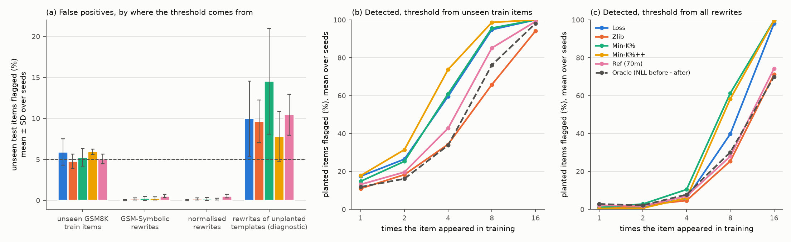
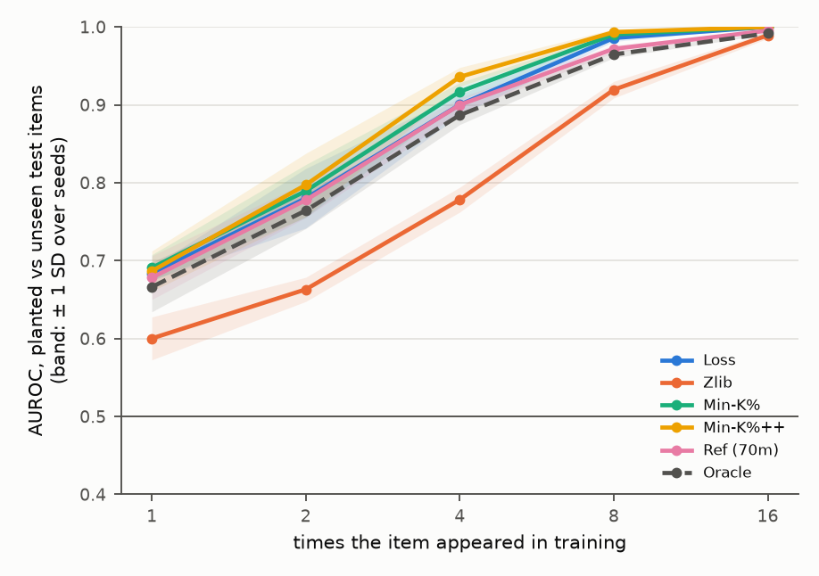
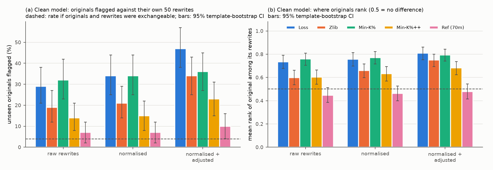

# Planted Contamination

Benchmark-contamination audits usually cannot be checked, because nobody knows which test items a
model really saw. This repository builds a model where the answer is known: GSM8K test items are
planted into the continued pretraining of Pythia-160M a chosen number of times, over five seeds.
On that model it tests five membership detectors and, mainly, one common way of setting their
threshold: treating rewritten versions of the benchmark (here GSM-Symbolic [14]) as the
"certainly unseen" reference.

## Findings

- **Rewrites are not a neutral reference, even on a clean model.** Before any planting, an
  original GSM8K question outranks its own 50 GSM-Symbolic rewrites far more often than chance:
  with the Loss score, 29% of the 100 never-seen originals land above a 5% threshold
  built from their own rewrites, where exchangeability allows 3.9%. That rate is
  descriptive. Two pre-registered tests bear on it: the original's mean rank among its own
  normalised rewrites differs from 0.5 for Loss, Zlib, Min-K% and Min-K%++ (H2, Holm p < 0.001);
  and with one threshold pooled over all 5,000 rewrites (H1) the excess is significant for Min-K%
  (11%) and Min-K%++ (10%) but not for Loss (6%). The base model has seen neither set, so none of this preference is
  membership: a classifier on surface features alone (length, digits, currency signs) separates
  originals from rewrites when all texts are pooled (AUROC 0.70, against
  0.48–0.58 for the detectors), and normalising the surface form or adjusting for length
  and digit share does not remove the detectors' preference. For the reference-model score (Ref)
  no test rejects a mean rank of 0.5, though its intervals are too wide to show it is unbiased.
- **On a contaminated model, the pooled rewrite threshold is miscalibrated.** Training on an item
  also raises the scores of its rewrites (spill-over; all five detectors, Holm p < 0.001). With 50
  of the 100 template originals planted 16 times, the pooled rewrite threshold rises: it flags
  0.0–0.5% of unseen test items instead of 5%, and catches 4.7–10.5% of items seen 4 times,
  against 34.3–73.8% with a threshold from unseen GSM8K train items (which flags
  4.8–5.9%). Averaged over seeds, 98.6–100% of the rewrites above the pooled threshold
  belong to planted templates (lowest single seed 96.4%; a diagnostic added after the
  first seed). Only this one contamination level was run.
- **Comparing each original with its own rewrites keeps its false alarms.** On the contaminated
  model it catches the planted originals (all of them for four detectors, 99.2% for Ref)
  but still flags 12–41% of the unplanted ones, against 7–32% of all 100 originals on the
  clean model; Ref rises from 7% to 24%.
- **An unseen in-distribution reference comes close to its promise.** Thresholds from 1,000 unseen
  GSM8K train items flag 4.8–5.9% of the 619 unseen test items and give the expected
  dose-response (figure 1b). Two caveats: on the base model, test items already score slightly
  above train items (AUROC up to 0.538); and here the train split is unseen by
  construction, which a real auditor usually cannot assume.



*Figure 1. Fine-tuned models, mean over 5 seeds. (a) Share of the 619 unseen test items flagged
when the 5% threshold is built from each reference set; error bars are ± 1 SD over seeds; the
dashed line is the 5% target. The last group is a diagnostic an auditor cannot run: rewrites of
the 50 templates whose original was not planted. (b, c) Share of planted items flagged, by number
of exposures, with the threshold from unseen train items (b) and from all raw rewrites (c).*

## Setup

**Models.** Target: `EleutherAI/pythia-160m-deduped` [15]. Reference model for the Ref detector:
`EleutherAI/pythia-70m-deduped`, which shares the tokenizer and pretraining data. Both are pinned to
fixed revisions in `scripts/run_experiments.py`.

**Data.** GSM8K [16] was released in October 2021 and GSM-Symbolic [14] in 2024, both after the
Pile [17] (December 2020) that Pythia was trained on, so the base model has seen neither. This
rests on the dates: the negative controls below can show that no split or group was favoured
before training, not that the base model never saw GSM8K. GSM-Symbolic `main` holds 100 templates
built from GSM8K test items, with 50 rewrites each (new names and numbers, same reasoning). Every
item is formatted as `Question: ...\nAnswer: ...` with GSM8K's calculator annotations removed.

**Planting.** For each of 5 seeds, with fresh random groups each time:

- of the 1,219 GSM8K test items that are not template originals, five groups of 120 are planted
  1, 2, 4, 8 and 16 times respectively, and the other 619 stay unseen;
- of the 100 template originals, 50 are planted 16 times and 50 stay unseen.

The planted copies are mixed into 4M tokens of WikiText-103 [18] and the model is trained on the
mix for one epoch (continued pretraining, about 4.6M tokens of which about 13% are planted; AdamW,
cosine schedule, batch 16 x 512). Training runs in float32 throughout: under bfloat16 autocast the
rounding of Pythia's large logits distorted the loss (ANALYSIS_PLAN.md, section 7). Each copy
sits whole inside one 512-token block between end-of-text tokens, the copies of one item go to
different blocks, and every block is trained on.

**Detectors.** Every score is oriented so that higher means "more likely seen in training".

| Detector | Score | Source |
|---|---|---|
| Loss | minus the mean token negative log-likelihood (NLL) | Yeom et al. [4] |
| Zlib | mean log-likelihood divided by the zlib-compressed length in bytes | Carlini et al. [3] |
| Min-K% | mean of the lowest 20% of token log-probabilities | Shi et al. [1] |
| Min-K%++ | mean of the lowest 20% of (log p - mu) / sigma, mu and sigma taken over the next-token distribution | Zhang et al. [2] |
| Ref (70m) | NLL under pythia-70m minus NLL under the target | difficulty calibration [22], MIMIR [5] |
| Oracle | NLL before fine-tuning minus NLL after | needs the model before fine-tuning, which an auditor never has; not an upper bound (it trails every detector except Zlib in table 1) |

Texts are scored with an end-of-text token in front, the same context every planted copy had in
training.

**Thresholds.** A flag is raised when a score is strictly above the split-conformal threshold
[23]: with n reference scores, the ceil((n + 1) x 0.95)-th smallest. If the reference items and
a new unseen item are exchangeable, the new item is flagged with probability at most 5%. The
question is what happens when they are not.

**Statistics.** Metrics on the fine-tuned models are computed within a seed and averaged over the
5 seeds (mean ± standard deviation). The clean-model audit uses the single base model, with
intervals over templates only. Intervals that involve rewrites resample whole templates, because
the 50 rewrites of one template are strongly correlated. Three hypotheses were fixed in
[ANALYSIS_PLAN.md](ANALYSIS_PLAN.md) before the main runs and are tested with permutation tests,
Holm-corrected over the five detectors.

- **H1.** On the clean base model, with one threshold pooled over all 5,000 raw rewrites, more
  than 5% of the 100 unseen originals are flagged. Test: within-template exchangeability (in each
  template a random one of the 51 texts plays the original), 10,000 draws.
- **H2.** After surface normalisation, an original still ranks differently from its own rewrites
  (mean rank differs from 0.5). Same permutation scheme, two-sided.
- **H3.** Fine-tuning on an original raises the scores of its rewrites (spill-over): the
  difference in differences of the rewrites' score gain, planted templates minus unplanted
  templates, is above zero. Test: planted labels permuted across templates within each seed.

**What changed after the plan.** The plan was committed before the main runs; the order rests on
this repository's commit history, not on an external registry. After that commit: the learning
rate was set by its pilot rule (GSM8K train items only, no test items touched); four fixes were
made before any main run (section 7: float32 training, every planted copy trained on, the
conformal threshold rule, bookkeeping), in the same commit that wrote the analysis code, including
the permutation tests for H1-H3, which the plan names but does not specify; some analyses were
added after the first seed had finished (section 8: thresholds from the rewrites of unplanted
templates, the share of above-threshold rewrites that come from planted templates, the
normalised-rewrite version of the contaminated audit, the template-group negative control, the
blind baseline's within-template rank); and one, the NLL drop of unplanted originals and their
rewrites, after all five seeds. These are marked post hoc where they appear and change no
pre-registered number.

## Results

All numbers below come from `scripts/analyze.py`; every table, with intervals and per-seed values,
is in [`results/pythia-160m-deduped-lr3e-05/summary.md`](results/pythia-160m-deduped-lr3e-05/summary.md)
and `summary.json`. The learning rate (3e-5) was set by the pre-registered pilot rule: at 1e-4,
Loss already reached AUROC 0.993 on items seen 4 times
([pilot](results/pythia-160m-deduped-lr0.0001-pilot/pilot_lr0.0001.json)).

### The test bed behaves as it should

Before training, every dose group is indistinguishable from the unseen items when the AUROC is
averaged over the five seeds' draws (0.479–0.518, every 90% interval inside 0.5 ± 0.05; single
draws range from 0.438 to 0.569). The 50 template originals drawn for planting sit slightly
below the 50 left unplanted (seed means 0.448–0.476, intervals reaching down to 0.41; a post hoc
control), which, if anything, makes them harder to catch. GSM8K test and train items differ only slightly on the base
model (AUROC 0.511–0.538; for Loss, Min-K% and Min-K%++ the 90% interval reaches past 0.55). After
training, detection rises with the number of exposures, from AUROC 0.60–0.69 for a single exposure to
at least 0.989 at 16.



**Table 1. Test bed:** AUROC of planted vs unseen test items (mean ± SD over 5 seeds).

| Detector | k = 1 | k = 2 | k = 4 | k = 8 | k = 16 |
|---|---|---|---|---|---|
| Loss | 0.684 ± 0.008 | 0.780 ± 0.038 | 0.900 ± 0.013 | 0.986 ± 0.005 | 1.000 ± 0.000 |
| Zlib | 0.600 ± 0.028 | 0.663 ± 0.016 | 0.778 ± 0.016 | 0.919 ± 0.011 | 0.989 ± 0.004 |
| Min-K% | 0.691 ± 0.017 | 0.789 ± 0.034 | 0.917 ± 0.012 | 0.990 ± 0.003 | 1.000 ± 0.000 |
| Min-K%++ | 0.687 ± 0.026 | 0.797 ± 0.041 | 0.936 ± 0.012 | 0.993 ± 0.004 | 1.000 ± 0.000 |
| Ref (70m) | 0.678 ± 0.028 | 0.778 ± 0.022 | 0.900 ± 0.010 | 0.972 ± 0.005 | 0.995 ± 0.001 |
| Oracle | 0.666 ± 0.032 | 0.764 ± 0.023 | 0.887 ± 0.012 | 0.965 ± 0.004 | 0.992 ± 0.001 |

### Rewrites on a clean model: originals look "seen"

GSM8K appeared after the Pile, so on the base model all 100 template originals are unseen. If
rewrites were a fair stand-in for unseen text, an original would rank anywhere among its own 50
rewrites with equal probability. It does not: with Loss and Min-K% the original ranks above about
three quarters of its rewrites, and 29% (Loss) and 32% (Min-K%) of the originals
exceed a 5% threshold built from their own rewrites, against 3.9% under exchangeability.
Undoing GSM-Symbolic's surface changes (currency signs, `.0`, `÷`, spacing), scoring the question
only, and adjusting for token count and digit share do not remove it (table 2). Pooling all 5,000
rewrites into one threshold dilutes it, because templates differ more from each other than an
original differs from its rewrites, but Min-K% and Min-K%++ still flag 11% and 10%
(H1, Holm p < 0.01).

The model has seen neither set, so this is distribution shift, not membership. A logistic
regression on surface features alone (characters, tokens, digits, longest number, non-ASCII
share, currency signs, `.0`), cross-validated by template, separates originals from rewrites
better than the detectors when all texts are pooled (AUROC 0.70 against
0.48–0.58). Within a template (a post hoc comparison) it is not better everywhere: its mean rank is
0.66 on raw rewrites, below Loss (0.73) and Min-K% (0.76), and
0.79 [0.74, 0.84] on normalised ones, level with Min-K% (0.77).
The reference-model score, which subtracts how predictable a text is to a smaller model trained
on the same data, has a mean rank of 0.45 (raw rewrites), 0.46 (normalised), 0.48 (normalised + adjusted), 0.48 (question only, raw), 0.51 (question only, normalised). No test rejects 0.5 for it, but the 95%
intervals (lowest bound 0.39, highest 0.57) are too wide to call it unbiased, and it still flags
7% of originals against their own rewrites.



*Figure 2. Clean base model, 100 originals with 50 rewrites each; error bars are 95%
template-bootstrap intervals. (a) Originals flagged against their own rewrites; the dashed line
is the rate under exchangeability. (b) Mean rank of the original among its own rewrites.*


**Table 2. Rewrite audit on the clean base model** (100 unseen originals, 50 rewrites each). Rank: mean rank of the original among its own rewrites (0.5 under exchangeability). Flagged: originals above a 5% conformal threshold from their own rewrites (3.9% under exchangeability; pooled column: at most 5%). Brackets: 95% template-bootstrap intervals.

| Detector | Rank, raw | Flagged, raw | Flagged, normalised | Flagged, normalised + adjusted | Flagged, question only (raw rewrites) | Flagged by the pooled raw-rewrite threshold |
|---|---|---|---|---|---|---|
| Loss | 0.734 [0.68, 0.79] | 29% | 34% | 47% | 31% | 6% [3, 13] |
| Zlib | 0.599 [0.54, 0.66] | 19% | 21% | 34% | 24% | 5% [3, 8] |
| Min-K% | 0.759 [0.71, 0.81] | 32% | 34% | 36% | 26% | 11% [6, 16] |
| Min-K%++ | 0.602 [0.54, 0.66] | 14% | 15% | 23% | 15% | 10% [4, 14] |
| Ref (70m) | 0.448 [0.39, 0.51] | 7% | 7% | 10% | 3% | 1% [0, 4] |

### Rewrites on a contaminated model: spill-over

Fine-tuning on an original raises the scores of its rewrites too. Per template, the average Loss
gain of the rewrites is 0.90 nats per token larger when the original was planted than when
it was not (H3, all five detectors, Holm p < 0.001). Rewrites keep the wording of the original and
change names and numbers, so this is expected; its consequence for the audit is the point.

- **Pooled rewrite threshold.** Averaged over seeds, 98.6–100% of the raw rewrites above it
  belong to planted templates (lowest single seed 96.4%; post hoc diagnostic). The
  threshold rises with them, flags 0.0–0.5% of unseen test items, and catches only 4.7–10.5% of
  items seen 4 times (table 3). Built from the rewrites of the unplanted templates instead, which an
  auditor cannot do, the same threshold flags 7.8–14.5% of unseen items, above the 5% target
  and above the 2–10% of all 1,319 test items that the pooled raw-rewrite threshold flags
  on the clean model. In this design (50 of 100 templates planted 16 times) the rewrite threshold
  lost most of its power; the diagnostic suggests that how much it loses depends on how much of
  the benchmark is contaminated and how often, which a real auditor does not know, but only this
  one contamination level was run.
- **Own-rewrite comparison.** Planted originals beat their rewrites (all of them for four
  detectors, 99.2% for Ref), but 12–41% of the unplanted originals are flagged too.
  Ref, with no significant bias on the clean model (7% flagged), flags 24%.
  Ref changes only through the target model, so fine-tuning lowered the NLL of the unplanted
  originals more than that of their own rewrites (0.92 against 0.81 nats per
  token, averaged over seeds; a post hoc check added after all five seeds). Every run planted
  GSM8K items, so this does not separate the effect of the planted GSM8K text from that of the
  fine-tuning as such.


**Table 3. Where the threshold comes from** (fine-tuned models, 5% target, % of items flagged, mean ± SD over seeds).

| Detector | train items: unseen flagged | train items: k = 1 caught | train items: k = 4 caught | all raw rewrites: unseen flagged | all raw rewrites: k = 1 caught | all raw rewrites: k = 4 caught | raw rewrites of unplanted templates (diagnostic): unseen flagged | same: k = 4 caught |
|---|---|---|---|---|---|---|---|---|
| Loss | 5.9 ± 1.6 | 17.5 ± 1.6 | 59.7 ± 4.0 | 0.0 ± 0.1 | 0.3 ± 0.5 | 5.8 ± 2.6 | 10.0 ± 4.6 | 70.8 ± 7.8 |
| Zlib | 4.8 ± 0.9 | 11.0 ± 2.8 | 34.3 ± 3.3 | 0.2 ± 0.1 | 0.5 ± 0.7 | 4.7 ± 1.3 | 9.7 ± 2.6 | 44.7 ± 8.3 |
| Min-K% | 5.3 ± 1.1 | 14.8 ± 1.5 | 61.0 ± 3.7 | 0.3 ± 0.2 | 1.0 ± 1.4 | 10.5 ± 4.0 | 14.5 ± 6.4 | 82.0 ± 8.5 |
| Min-K%++ | 5.9 ± 0.3 | 17.8 ± 4.3 | 73.8 ± 6.1 | 0.3 ± 0.2 | 0.5 ± 0.7 | 6.0 ± 2.7 | 7.8 ± 3.0 | 77.8 ± 4.6 |
| Ref (70m) | 5.1 ± 0.6 | 13.2 ± 4.3 | 42.8 ± 3.4 | 0.5 ± 0.2 | 2.2 ± 0.5 | 7.0 ± 2.5 | 10.5 ± 2.5 | 64.7 ± 3.6 |
| Oracle | 4.6 ± 0.2 | 11.8 ± 4.1 | 33.8 ± 2.9 | 1.1 ± 0.2 | 2.8 ± 0.5 | 7.8 ± 2.3 | 12.8 ± 3.4 | 64.8 ± 6.9 |


**Table 4. Rewrite audit on the contaminated model** (50 template originals planted 16 times, 50 unseen; raw rewrites; % flagged, mean ± SD over seeds) **and spill-over.**

| Detector | Own rewrites: planted caught | Own rewrites: unseen flagged | Pooled rewrites: planted caught | Pooled rewrites: unseen flagged | Spill-over AUROC (planted vs unplanted templates) |
|---|---|---|---|---|---|
| Loss | 100.0 ± 0.0 | 40.4 ± 7.5 | 97.2 ± 3.0 | 0.0 ± 0.0 | 0.944 ± 0.010 |
| Zlib | 100.0 ± 0.0 | 29.2 ± 6.1 | 66.4 ± 5.2 | 0.0 ± 0.0 | 0.835 ± 0.002 |
| Min-K% | 100.0 ± 0.0 | 41.2 ± 6.4 | 99.2 ± 1.1 | 0.0 ± 0.0 | 0.904 ± 0.011 |
| Min-K%++ | 100.0 ± 0.0 | 12.0 ± 5.3 | 100.0 ± 0.0 | 0.0 ± 0.0 | 0.902 ± 0.010 |
| Ref (70m) | 99.2 ± 1.1 | 24.0 ± 5.3 | 73.2 ± 5.4 | 0.0 ± 0.0 | 0.944 ± 0.010 |

### Pre-registered hypotheses

H1 is supported for Min-K%, Min-K%++ only (not significant for the others); H2 is supported for
Loss, Zlib, Min-K%, Min-K%++, and not significant for Ref, which does not show that Ref is unbiased; H3 is
supported for all five.
Loss and Ref have the same spill-over by construction: the reference model's NLL cancels in the
before-minus-after difference.


**Table 5. Pre-registered hypotheses** (permutation tests, Holm-corrected over the five detectors).

| Detector | H1: clean originals flagged (pooled raw-rewrite threshold) | Holm p | H2: mean rank, normalised | Holm p | H3: spill-over, difference in differences | Holm p |
|---|---|---|---|---|---|---|
| Loss | 6% | 1.000 | 0.758 | < 0.001 | 0.904 | < 0.001 |
| Zlib | 5% | 1.000 | 0.659 | < 0.001 | 0.00361 | < 0.001 |
| Min-K% | 11% | < 0.001 | 0.770 | < 0.001 | 2.06 | < 0.001 |
| Min-K%++ | 10% | 0.008 | 0.631 | < 0.001 | 4.18 | < 0.001 |
| Ref (70m) | 1% | 1.000 | 0.462 | 0.200 | 0.904 | < 0.001 |

### What this adds

Distribution shift between members and non-members is a known reason membership inference looks
better than it is (Duan et al. [5], Das et al. [6], Meeus et al. [8]); rewrite- and
fresh-sample-based contamination checks are common (Xu et al. [11], ConStat [12], GSM1k [13],
neighbourhood comparison [9]); and planting text with known exposure counts has been used before
(Meeus et al. [19], Jiang et al. [20]). The contribution here is a controlled measurement, on one
160M model and one contamination level, of what a rewrite reference does to an audit when the
truth is known. On the clean model, originals outrank their own rewrites for every detector
except Ref (with one pooled threshold the excess is significant only for Min-K% and Min-K%++). On
the contaminated model, spill-over lifts the rewrites of planted items so far that the pooled
rewrite threshold misses most items seen 4 times, while the own-rewrite comparison keeps flagging
unplanted originals. A held-out sample from the benchmark's own distribution, when one exists,
comes close to the promised false-positive rate.

## Reproduce

Tested with Python 3.14.8 on macOS (Apple M6). The scripts use Apple's MPS backend when it is
available and the CPU otherwise.

```sh
python3.14 -m venv .venv && .venv/bin/pip install -r requirements.txt
.venv/bin/python -m pytest -q tests                       # 17 tests, CPU only; one downloads pythia-70m
PYTHON=.venv/bin/python scripts/run_all.sh                # pilot, 5 seeds, tables and figures
```

`run_all.sh` takes about 3 hours on an Apple M6 (MPS): the learning-rate pilot, scoring every
text set with the base and reference models once, then about 30 minutes per seed. Models and
datasets are downloaded from the Hugging Face Hub at pinned revisions. Per-item scores (ids and
numbers only) land in `results/<tag>/`.

The per-item scores of this run are committed, and `run_experiments.py` skips every seed whose
`scores_seed*.csv.gz` and `groups_seed*.json` exist and reuses `scores_base.csv.gz`. So on a fresh
clone `run_all.sh` reruns only the pilot and the reference-model scoring before rebuilding the
tables. To retrain from scratch, delete the committed scores first, keeping `texts.sha256`, which
checks that the downloaded benchmark texts match the ones used here:
`(cd results/pythia-160m-deduped-lr3e-05 && rm scores_* groups_* trainlog_*)`. To rebuild only the
tables and figures, run `.venv/bin/python scripts/analyze.py --tag pythia-160m-deduped-lr3e-05`
(a few minutes on CPU, no GPU).

## Repository layout

| Path | What it does |
|---|---|
| `src/pc/data.py` | loading at pinned revisions, item formatting, surface normalisation, group assignment, packing the contaminated corpus |
| `src/pc/train.py` | continued pretraining, a plain PyTorch loop (AdamW, warmup + cosine, gradient accumulation and clipping) |
| `src/pc/score.py` | per-token log-probabilities and next-token mean and spread, length-sorted batching, the detector scores |
| `src/pc/metrics.py` | AUROC, conformal threshold, Holm adjustment, bootstrap and Wilson intervals |
| `scripts/run_experiments.py` | pilot and main runs; writes per-item scores |
| `scripts/analyze.py` | every table and figure in this README |
| `scripts/run_all.sh` | the whole pipeline: pilot, learning rate by the pilot rule, five seeds, analysis |
| `results/pythia-160m-deduped-lr3e-05/` | per-item scores of the five seeds, the groups and exposure steps of every seed, training logs, `summary.md` and `summary.json` |
| `results/pythia-160m-deduped-lr0.0001-pilot/pilot_lr0.0001.json` | the learning-rate pilot: AUROC per detector and exposure, and the decision (3e-5) |
| `tests/` | detector maths against brute force, AUROC against Mann-Whitney, conformal false-positive rate, exact copy counts in the corpus, batching invariance, an end-to-end run of the analysis on synthetic scores |
| `ANALYSIS_PLAN.md` | the design and hypotheses, committed before the main runs |

## Limitations

- Planted text is about 13% of the fine-tuning tokens, far more than any real contamination
  rate. The filler is not neutral either: the training loss falls from about 4.7-5.1 to about 3.1
  nats per token over the epoch (`trainlog_seed*.json`), while the planted tokens, about 3.36
  nats each on the base model, can account for at most about 0.45 of that drop, so most of the
  adaptation is to the filler. Fine-tuning also lowers the NLL of never-planted GSM8K items by
  about 0.9 nats per token.
- Continued pretraining on 4.6M tokens is not pretraining on hundreds of billions; a planted item
  here is also seen close to the end of training.
- One small model (160M parameters), one learning rate, one benchmark family.
- The rewrite audit is simulated with GSM-Symbolic only; other rewriting schemes may differ in how
  far they move the surface form.

## Data and licences

Code: MIT. No benchmark text is stored in this repository: GSM8K (MIT) and GSM-Symbolic
(CC BY-NC-ND 4.0) are downloaded at run time, and results files hold item ids, scores and simple
surface statistics (lengths, digit counts), no text.
WikiText-103 is CC BY-SA 3.0; the Pythia models are Apache-2.0.

## References

1. Shi et al. Detecting Pretraining Data from Large Language Models. ICLR 2024. arXiv:2310.16789
2. Zhang et al. Min-K%++: Improved Baseline for Detecting Pre-Training Data from Large Language Models. ICLR 2025. arXiv:2404.02936
3. Carlini et al. Extracting Training Data from Large Language Models. USENIX Security 2021. arXiv:2012.07805
4. Yeom et al. Privacy Risk in Machine Learning: Analyzing the Connection to Overfitting. IEEE CSF 2018. arXiv:1709.01604
5. Duan et al. Do Membership Inference Attacks Work on Large Language Models? COLM 2024. arXiv:2402.07841
6. Das, Zhang, Tramèr. Blind Baselines Beat Membership Inference Attacks for Foundation Models. arXiv:2406.16201, 2024
7. Maini et al. LLM Dataset Inference: Did you train on my dataset? NeurIPS 2024. arXiv:2406.06443
8. Meeus et al. SoK: Membership Inference Attacks on LLMs are Rushing Nowhere (and How to Fix It). IEEE SaTML 2025. arXiv:2406.17975
9. Mattern et al. Membership Inference Attacks against Language Models via Neighbourhood Comparison. Findings of ACL 2023. arXiv:2305.18462
10. Oren et al. Proving Test Set Contamination in Black Box Language Models. ICLR 2024. arXiv:2310.17623
11. Xu et al. Benchmarking Benchmark Leakage in Large Language Models. arXiv:2404.18824, 2024
12. Dekoninck, Müller, Vechev. ConStat: Performance-Based Contamination Detection in Large Language Models. NeurIPS 2024. arXiv:2405.16281
13. Zhang et al. A Careful Examination of Large Language Model Performance on Grade School Arithmetic. NeurIPS 2024 Datasets and Benchmarks Track. arXiv:2405.00332
14. Mirzadeh et al. GSM-Symbolic: Understanding the Limitations of Mathematical Reasoning in Large Language Models. ICLR 2025. arXiv:2410.05229
15. Biderman et al. Pythia: A Suite for Analyzing Large Language Models Across Training and Scaling. ICML 2023. arXiv:2304.01373
16. Cobbe et al. Training Verifiers to Solve Math Word Problems. arXiv:2110.14168, 2021
17. Gao et al. The Pile: An 800GB Dataset of Diverse Text for Language Modeling. arXiv:2101.00027, 2020
18. Merity et al. Pointer Sentinel Mixture Models. ICLR 2017. arXiv:1609.07843
19. Meeus et al. Copyright Traps for Large Language Models. ICML 2024. arXiv:2402.09363
20. Jiang et al. Investigating Data Contamination for Pre-training Language Models. arXiv:2401.06059, 2024
21. Wu et al. AntiLeakBench: Preventing Data Contamination by Automatically Constructing Benchmarks with Updated Real-World Knowledge. ACL 2025. arXiv:2412.13670
22. Watson et al. On the Importance of Difficulty Calibration in Membership Inference Attacks. ICLR 2022. arXiv:2111.08440
23. Angelopoulos, Bates. A Gentle Introduction to Conformal Prediction and Distribution-Free Uncertainty Quantification. arXiv:2107.07511, 2021
